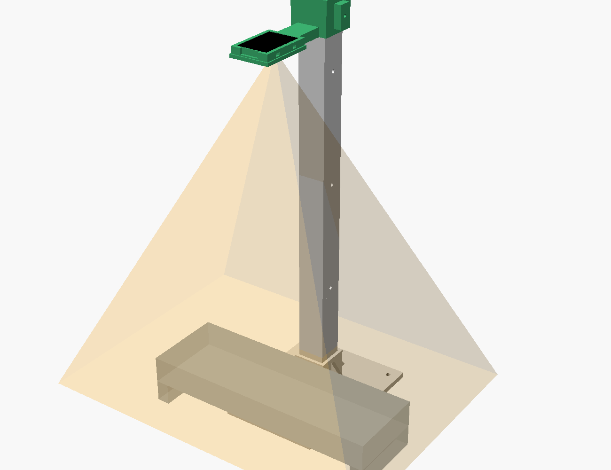

# Suporte da ESP32-CAM para a Modular Conveyor (3Core)

Suporte **independente** para a câmera ficar a 300 mm da correia, centralizada sobre a esteira. Não altera nenhum arquivo da esteira original, que tem licença de uso pessoal e não pode ser redistribuída. Imprimam a esteira pelo MakerWorld ou Printables e este suporte à parte.

## Peças

| Arquivo | Quantidade | Observação |
| --- | --- | --- |
| `base_suporte.stl` | 1 | Fica ao lado da esteira; a língua fina (3 mm) entra por baixo dela |
| `segmento_coluna.stl` | 4 | Encaixam um no outro; travar com parafuso M3 × 30 e porca |
| `braco_camera.stl` | 1 | Colar deslizante + berço da ESP32-CAM, lente para baixo |

Ferragens: 4 parafusos M3 × 30 com porca (pinos da coluna), 1 M3 × 16 (aperto do colar), abraçadeiras de nylon e, opcionalmente, 4 parafusos para madeira para fixar a base numa tábua.