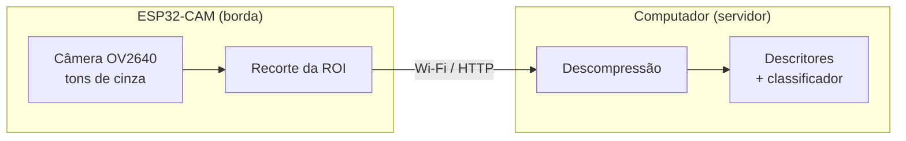
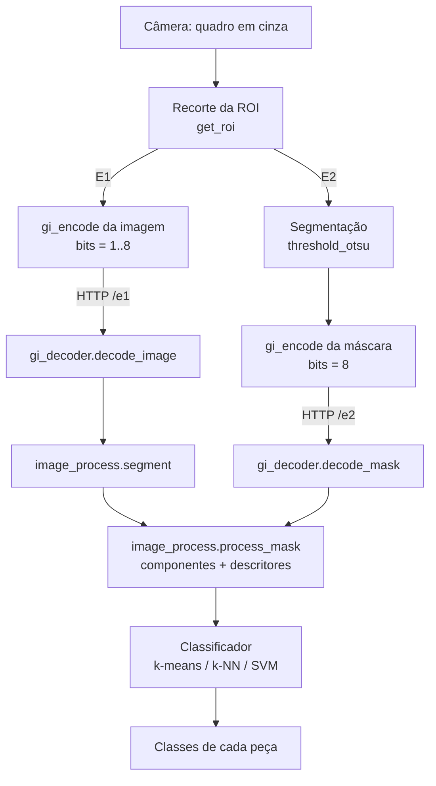

# Arquitetura do sistema

Este documento explica **como o sistema funciona como um todo**: as duas estratégias de transmissão, o caminho dos dados da câmera até a classificação e as decisões de projeto que amarram a placa ao servidor.

## Sumário

1. [Visão geral](#1-visão-geral)
2. [As duas estratégias: E1 e E2](#2-as-duas-estratégias-e1-e-e2)
3. [Caminho dos dados](#3-caminho-dos-dados)
4. [A segmentação é idêntica na placa e no servidor](#4-a-segmentação-é-idêntica-na-placa-e-no-servidor)
5. [Compressão GI](#5-compressão-gi)
6. [Descritores e classificação](#6-descritores-e-classificação)
7. [Medição de tempos e tamanhos](#7-medição-de-tempos-e-tamanhos)
8. [Mapa dos módulos](#8-mapa-dos-módulos)

---

## 1. Visão geral

O sistema simula uma estação de inspeção em linha de produção. Uma **ESP32-CAM** (borda) fotografa as peças sobre a esteira e um **computador** (servidor) identifica cada uma entre cinco classes: parafuso, porca, sensor ultrassônico, servo e motor DC.

A pergunta central do projeto é **o que a borda deve enviar pela rede**. Por isso o sistema implementa duas estratégias, que dividem o trabalho de formas diferentes entre placa e servidor, e mede o custo de cada uma.



## 2. As duas estratégias: E1 e E2

| | **E1: imagem inteira** | **E2: máscara binária** |
| --- | --- | --- |
| A placa faz | captura + compressão GI da imagem em cinza | captura + segmentação + compressão GI da máscara |
| A placa envia | imagem em cinza comprimida (1 a 8 bits por pixel) | máscara 0/1 comprimida (sem perdas) |
| O servidor faz | descompressão + segmentação + descritores + classificação | descompressão + descritores + classificação |
| Tamanho típico | dezenas a centenas de KB (depende dos bits) | da ordem de 1 KB |
| Custo na placa | baixo (só comprime) | maior (segmenta e comprime) |
| Perdas | com menos de 8 bits, a imagem é quantizada | nenhuma: a máscara chega exata |

Para comparação, a E1 também pode usar **JPEG** (`/e1?codec=jpeg`) e a E2 pode ser enviada **sem compressão** (`/e2?fmt=bits`).

## 3. Caminho dos dados



A placa é **passiva**: ela fica esperando pedidos HTTP. É o servidor que pede cada quadro, o que permite medir a latência de ida e volta sem sincronizar relógios.

## 4. A segmentação é idêntica na placa e no servidor

Na E2, a máscara é feita **na ESP32**. Na E1 e no treinamento, ela é feita **no servidor** (`image_process.py`). O modelo é treinado com máscaras do servidor, então, se as duas segmentações fossem diferentes, a E2 seria testada com um tipo de máscara que o modelo nunca viu.

Por isso a segmentação foi escrita **duas vezes, com exatamente as mesmas contas**:

| Etapa | ESP32 (`image_process.h`) | Servidor (`image_process.py`) |
| --- | --- | --- |
| 1. Diferença com o fundo (se houver) | `abs(gray - background)` | `np.abs(g - background)` |
| 2. Gaussiano K×K binomial, inteiro | `gaussian_blur()` | `gaussian_blur()` |
| 3. Limiar de Otsu | `otsu()` | `otsu()` |
| 4. Abertura K×K | `erode()` + `dilate()` | `erode()` + `dilate()` |
| 5. Fechamento K×K | `dilate()` + `erode()` | `dilate()` + `erode()` |

Detalhes que garantem o resultado bit a bit igual:

- o gaussiano usa o **kernel binomial** (linhas do triângulo de Pascal: [1 2 1], [1 4 6 4 1], ...) em aritmética inteira, com uma única divisão arredondada no final;
- a borda da imagem é **refletida sem repetir o pixel da borda** (`BORDER_REFLECT_101` do OpenCV, `reflect` do NumPy);
- o Otsu percorre o histograma na mesma ordem e desempata do mesmo jeito (fica com o primeiro máximo);
- na morfologia, pixels fora da imagem são ignorados.

As constantes que controlam a segmentação precisam ser **iguais nos dois lados**:

| Firmware (`image_process.h`) | Servidor (`config.py`) | Função |
| --- | --- | --- |
| `OBJ_CLARO` | `BRIGHT_OBJECT` | sem fundo: a peça é mais clara que o fundo? |
| `GAUSS_K` | `GAUSS_K` | tamanho do gaussiano (1 desliga, 3, 5, 7 ou 9) |
| `OPEN_K` | `OPEN_K` | tamanho da abertura (0 ou 1 desliga) |
| `CLOSE_K` | `CLOSE_K` | tamanho do fechamento (0 ou 1 desliga) |

O `parity_test.py` confere isso na prática: pede à placa a imagem e a máscara **do mesmo quadro**, segmenta a imagem em Python e compara pixel a pixel. O esperado é zero pixels diferentes.

## 5. Compressão GI

O formato GI, implementado pelo grupo, combina **RLE** (codificação por comprimento de corrida) e **Huffman canônico**:

1. cada pixel é quantizado mantendo os `bits` bits mais significativos (8 = sem perdas);
2. a imagem vira uma sequência de corridas (comprimento, valor), com corridas de até 255 pixels;
3. comprimentos e valores ganham, cada um, uma tabela de Huffman própria;
4. o pacote leva só os **tamanhos** dos códigos; os códigos em si são reconstruídos pela regra canônica.

A compressão roda na **ESP32** (`rle_huff.cpp`) e a descompressão no **servidor**, em Python (`gi_decoder.py`). Detalhes do formato em [COMPRESSAO.md](COMPRESSAO.md).

Uma máscara binária é quase toda feita de longas sequências de zeros, o caso ideal para o RLE. Por isso a E2 comprimida fica dezenas de vezes menor que a máscara crua (1 bit por pixel).

## 6. Descritores e classificação

Para cada peça segmentada, o servidor recorta a máscara e calcula 15 descritores em três grupos:

| Grupo | Descritores | Por que ajudam |
| --- | --- | --- |
| `hu` | I1 a I8 (Hu + Flusser), com log | invariantes a translação, rotação e escala; descrevem a forma |
| `shape` | número de Euler, compacidade, excentricidade, alongamento, solidez | o número de Euler conta os furos: parafuso 1, porca 0, servo −1, sensor −3 |
| `size` | área, perímetro | com a câmera fixa, separam peças pequenas das grandes |

Os momentos são calculados sobre a **máscara binária**, não sobre a imagem em cinza: assim descrevem a forma da peça, e não reflexos ou variações de iluminação. A teoria está em [readme_moments.md](readme_moments.md).

O classificador principal é o **k-means supervisionado** (`KMeansClassifier`): o k-means agrupa os dados sem olhar os rótulos e cada grupo recebe a classe mais comum entre seus membros. Como uma classe pode formar vários grupos (o motor visto por faces diferentes, por exemplo), usa-se mais grupos que classes. Para comparação, o treinamento também avalia **k-NN** e **SVM**. A teoria do k-means está em [readme_kmeans.md](readme_kmeans.md).

## 7. Medição de tempos e tamanhos

Cada resposta da placa traz cabeçalhos com os tempos medidos nela, e o servidor mede o restante:

```
 servidor pede o quadro                                             servidor recebe
        |<------------------------ t_request_ms ------------------------->|
        |  t_capture_ms  |   t_edge_ms   |          t_network_ms          |
        |  captura + ROI | compressão    |   (rede, ida e volta)          |
        |                | (E2: + segm.) |                                |

 depois, no servidor:  t_decompress_ms -> t_segment_ms (só E1) -> t_descriptors_ms -> t_classify_ms
```

- `t_request_ms`: ida e volta do pedido HTTP, medida no servidor;
- `t_network_ms` = `t_request_ms` − `t_capture_ms` − `t_edge_ms` (estimativa do tempo de rede);
- `t_server_ms`: descompressão + segmentação + descritores + classificação;
- `t_total_ms` = `t_request_ms` + `t_server_ms`.

Os tamanhos registrados são `bytes_received` (o que trafegou), `raw_bytes` (o tamanho sem compressão) e `compression_ratio` (a razão entre os dois).

## 8. Mapa dos módulos

```
src/
├── edger/inspect_objectos/     firmware da ESP32-CAM          -> FIRMWARE.md
│   ├── inspect_objectos.ino    câmera, ROI, Wi-Fi, setup/loop
│   ├── camera_pins.h           pinos da AI Thinker
│   ├── image_process.h         ROI, gaussiano, Otsu, morfologia
│   ├── app_httpd.h             rotas HTTP
│   └── rle_huff.h / .cpp       compressão GI (cópia de Enconding/)
├── Enconding/                  compressão GI                  -> COMPRESSAO.md
│   ├── rle_huff.h / .cpp       codificador (C)
│   ├── decod.py                decodificador de referência (Python)
│   └── test_rle_huff.cpp       teste do codificador no PC
└── server/                     servidor (Python)              -> SERVIDOR.md
    ├── config.py               configurações
    ├── image_process.py        segmentação e descritores
    ├── moments.py, k_means.py  momentos e k-means
    ├── gi_decoder.py           descompressão GI
    ├── esp32_client.py         comunicação com a placa
    ├── capture_dataset.py      montagem do dataset
    ├── training_pipeline.py    pipeline de treinamento
    ├── classification_pipeline.py  pipeline de classificação
    └── parity_test.py          teste de paridade
```
