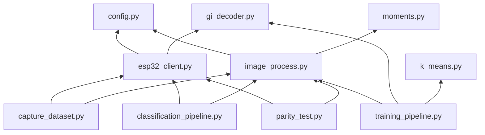

# Servidor (`src/server`)

Referência de cada módulo do servidor: o que faz, suas funções e como usar.

> **Como rodar:** os módulos importam uns aos outros como `src.server.…`. Por isso, rodem sempre **a partir da raiz do repositório**, como módulos:
> ```bash
> python -m src.server.training_pipeline
> ```
> Entrando em `src/server` e rodando `python training_pipeline.py`, o Python dá `ModuleNotFoundError: No module named 'src'`.

## Sumário

1. [Visão geral](#1-visão-geral)
2. [`config.py`](#2-configpy)
3. [`image_process.py`](#3-image_processpy)
4. [`moments.py`](#4-momentspy)
5. [`k_means.py`](#5-k_meanspy)
6. [`gi_decoder.py`](#6-gi_decoderpy)
7. [`esp32_client.py`](#7-esp32_clientpy)
8. [`capture_dataset.py`](#8-capture_datasetpy)
9. [`training_pipeline.py`](#9-training_pipelinepy)
10. [`classification_pipeline.py`](#10-classification_pipelinepy)
11. [`parity_test.py`](#11-parity_testpy)
12. [`legacy/`](#12-legacy)

---

## 1. Visão geral

| Módulo | Tipo | Função |
| --- | --- | --- |
| `config.py` | biblioteca | IP da placa, classes, pastas e parâmetros |
| `image_process.py` | biblioteca | Segmentação (espelho da ESP32), componentes e descritores |
| `moments.py` | biblioteca | Momentos brutos, centrais, normalizados e invariantes de Hu |
| `k_means.py` | biblioteca | Classificador k-means supervisionado |
| `gi_decoder.py` | biblioteca | Descompressão GI e cálculo do tamanho comprimido |
| `esp32_client.py` | biblioteca | Comunicação com a placa |
| `capture_dataset.py` | script | Monta o dataset |
| `training_pipeline.py` | script | **Pipeline de treinamento** |
| `classification_pipeline.py` | script | **Pipeline de classificação** |
| `parity_test.py` | script | Confere se placa e servidor segmentam igual |

Dependências entre os módulos (a seta aponta para o módulo usado):



## 2. `config.py`

Todas as configurações do servidor.

### Conexão e classes

| Nome | Padrão | Descrição |
| --- | --- | --- |
| `ESP32_URL` | `http://10.13.31.16` | Endereço da placa (o IP aparece no Monitor Serial) |
| `TIMEOUT_S` | 5 | Tempo máximo de espera de cada pedido, em segundos |
| `CLASSES` | `parafuso`, `porca`, `sensor_ultrassonico`, `servo`, `motor_dc` | Classes. A ordem define as teclas 1 a 5 da captura |

### Pastas

| Nome | Caminho | Conteúdo |
| --- | --- | --- |
| `ROOT` | `src/` | Base de todos os caminhos |
| `DATA_DIR` | `src/data/` | Dataset |
| `MODELS_DIR` | `src/server/models/` | Modelo treinado |
| `RESULTS_DIR` | `src/server/results/` | Gráficos, CSVs e telas salvas |
| `MODEL_PATH` | `src/server/models/classifier.joblib` | Arquivo do modelo |

> O `ROOT` é calculado subindo duas pastas a partir de `config.py`, o que dá `src/`. Por isso o dataset fica em **`src/data/`**, e não na pasta `data/` da raiz do repositório.

`paths(data_dir)` devolve os caminhos do dataset a partir de uma pasta de dados, o que permite trabalhar com outra pasta (argumento `--data`):

| Chave | Caminho |
| --- | --- |
| `raw` | `<data>/raw/`: fotos originais, sem compressão |
| `background` | `<data>/background/`: fotos da bandeja vazia, por sessão |
| `processed` | `<data>/processed/`: máscaras recortadas, para conferência |
| `metadata` | `<data>/metadata.csv`: uma linha por foto |
| `features` | `<data>/features.csv`: uma linha por peça segmentada |

### Segmentação e descritores

| Nome | Padrão | Descrição |
| --- | --- | --- |
| `USE_BACKGROUND` | `True` | Subtrai o fundo antes de limiarizar, quando há fundo |
| `BRIGHT_OBJECT` | `True` | Sem fundo: a peça é mais clara que o fundo? (igual a `OBJ_CLARO` do firmware) |
| `GAUSS_K` | 3 | Gaussiano (igual ao firmware) |
| `OPEN_K` | 3 | Abertura (igual ao firmware) |
| `CLOSE_K` | 3 | Fechamento (igual ao firmware) |
| `MIN_AREA` | 80 | Área mínima de uma peça, em pixels |
| `MIN_HOLE_AREA` | 8 | Furos menores que isso são considerados ruído |
| `BORDER_MARGIN` | 3 | Peças a menos disso da borda são consideradas cortadas |
| `CROP_PAD` | 4 | Margem ao recortar cada peça |

### Experimentos

| Nome | Padrão | Descrição |
| --- | --- | --- |
| `E1_BITS` | 1 a 8 | Níveis de bits testados na E1 |
| `E1_JPEG_Q` | 10, 30, 50, 70, 90 | Qualidades JPEG testadas na E1 (comparação) |

## 3. `image_process.py`

Segmentação, componentes conexos e descritores. As funções de segmentação são uma **cópia exata** das do firmware (ver [ARQUITETURA.md](ARQUITETURA.md#4-a-segmentação-é-idêntica-na-placa-e-no-servidor)).

### Constantes

| Nome | Conteúdo |
| --- | --- |
| `HU_NAMES` | `hu1` … `hu8` |
| `SHAPE_NAMES` | `euler`, `compactness`, `eccentricity`, `elongation`, `solidity` |
| `SIZE_NAMES` | `area`, `perimeter` |
| `FEATURE_NAMES` | os 15 descritores, nessa ordem |

### Funções

| Função | Descrição |
| --- | --- |
| `load_background(background_dir, session)` | Média arredondada das fotos `background_<session>_*.png` (mesma conta da ESP32); `None` se não houver |
| `grayscale(img)` | Converte para tons de cinza, se necessário |
| `binomial_kernel(k)` | Coeficientes binomiais do gaussiano |
| `gaussian_blur(img, k)` | Gaussiano k×k inteiro, igual ao da placa |
| `otsu(img)` | Limiar de Otsu, com o mesmo desempate da placa |
| `erode(mask, k)` / `dilate(mask, k)` | Erosão e dilatação com elemento quadrado k×k |
| `segment(img, background=None)` | Segmentação completa. Devolve `(máscara 0/255, limiar)` |
| `components(mask)` | Separa as peças. Cada peça é um dicionário (ver abaixo) |
| `descriptors(piece_mask)` | Os 15 descritores de uma peça, num dicionário |
| `process_mask(mask, ignore_border=True)` | Componentes + descritores a partir de uma máscara pronta (o que o servidor faz na **E2**) |
| `process_image(img, background=None, ignore_border=True)` | Segmentação + componentes + descritores (o que o servidor faz na **E1** e no treino). Devolve `(peças, máscara, limiar)` |
| `draw(img, objects, mask=None, labels=None)` | Imagem de conferência com contornos e caixas |

Cada peça devolvida por `components()` e `process_*()` é um dicionário:

| Chave | Conteúdo |
| --- | --- |
| `bbox` | `(x, y, largura, altura)` na imagem |
| `area_px` | área em pixels |
| `centroid` | `(x, y)` do centroide |
| `touches_border` | `True` se a peça encosta na borda (silhueta incompleta) |
| `mask` | máscara 0/255 recortada, com `CROP_PAD` de margem |
| `features` | dicionário com os 15 descritores (só em `process_*`) |

### Descritores

| Descritor | Cálculo |
| --- | --- |
| `hu1` … `hu8` | `moments.feature_vector()` sobre a máscara binária, com log |
| `euler` | 1 − nº de furos (contornos internos com área ≥ `MIN_HOLE_AREA`) |
| `compactness` | perímetro² / (4π · área): 1 para o círculo, maior para formas alongadas ou recortadas |
| `eccentricity` | √(1 − λ₂/λ₁), com λ os autovalores da matriz de momentos centrais de 2ª ordem |
| `elongation` | lado maior / lado menor do retângulo de área mínima |
| `solidity` | área do contorno / área do fecho convexo |
| `area` | nº de pixels da peça |
| `perimeter` | comprimento do contorno externo |

### Exemplo

```python
import cv2
import src.server.image_process as ip

img = cv2.imread("foto.png", cv2.IMREAD_GRAYSCALE)
background = ip.load_background("src/data/background", "s01")
pieces, mask, thres = ip.process_image(img, background)
for p in pieces:
    print(p["bbox"], p["features"]["euler"], p["features"]["area"])
```

## 4. `moments.py`

Momentos de imagem, conforme a teoria em [readme_moments.md](readme_moments.md).

| Função | Descrição |
| --- | --- |
| `moments(img, ordem=3)` | Devolve `(m, mu, nu)`: matrizes dos momentos brutos, centrais e normalizados até a ordem pedida, calculados de uma vez com matrizes de Vandermonde |
| `hu_invariants_moments(nu)` | Os 8 invariantes (I1 a I7 de Hu e I8 de Flusser) |
| `dict_moments(img)` | Os momentos num dicionário, para inspeção |
| `feature_vector(img, usar_log=True)` | Vetor dos 8 invariantes; com `usar_log`, aplica −sinal·log₁₀\|x\| para trazer valores de ordens de grandeza muito diferentes para a mesma escala |

## 5. `k_means.py`

`KMeansClassifier(n_clusters=3, n_init=10, max_iter=300, random_state=None)` transforma o k-means (não supervisionado) num classificador compatível com o scikit-learn:

- **`fit(X, y)`**: roda o k-means em `X` sem olhar os rótulos; depois, cada grupo recebe a classe mais comum entre seus membros (grupos vazios recebem a primeira classe);
- **`predict(X)`**: devolve a classe do grupo mais próximo de cada amostra.

Por ser um estimador do scikit-learn, entra direto em `Pipeline` e `GridSearchCV`. A teoria está em [readme_kmeans.md](readme_kmeans.md).

## 6. `gi_decoder.py`

Descompressão do pacote GI em Python. Referência completa em [COMPRESSAO.md](COMPRESSAO.md#5-decodificadores-em-python).

| Função | Uso principal |
| --- | --- |
| `decode_image(data)` | E1: bytes da resposta → imagem em cinza |
| `decode_mask(data)` | E2: bytes da resposta → máscara 0/255 |
| `quantize(img, bits)` | Simula a E1 offline |
| `compressed_size(img, bits)` | Tamanho exato do pacote, sem comprimir |

## 7. `esp32_client.py`

Encapsula a comunicação com a placa. Usa uma `requests.Session`, que mantém a conexão TCP aberta entre pedidos.

### `ESP32(url=config.ESP32_URL, timeout=config.TIMEOUT_S)`

| Método | Rota | Devolve |
| --- | --- | --- |
| `status()` | `/status` | dicionário com o estado da placa |
| `set(var, val)` | `/set` | texto da resposta |
| `background()` | `/fundo` | fundo guardado na placa (matriz) ou `None` |
| `capture_background()` | `/fundo?acao=capturar` | texto da resposta |
| `clear_background()` | `/fundo?acao=limpar` | texto da resposta |
| `raw()` | `/raw` | `Frame` com `img` |
| `e1(bits=8)` | `/e1?bits=…` | `Frame` com `img` (já descomprimida) |
| `e1_jpeg(quality=50)` | `/e1?codec=jpeg` | `Frame` com `img` |
| `e2(fmt="gi")` | `/e2?fmt=…` | `Frame` com `mask` 0/255 |
| `parity()` | `/paridade` | `(cinza, máscara 0/1, cabeçalhos)` do mesmo quadro |

Se a placa responder ao `/e1` ou `/e2` sem um pacote GI (firmware antigo), o cliente levanta um `RuntimeError` explicando o problema.

### `Frame`

| Campo | Descrição |
| --- | --- |
| `strategy` | `E1`, `E1-JPEG`, `E2`, `E2-bits`, `E2-bytes` ou `raw` |
| `img` / `mask` | imagem em cinza (E1, raw) ou máscara 0/255 (E2) |
| `bytes_received` | bytes que trafegaram |
| `raw_bytes` | tamanho sem compressão |
| `compression_ratio` | `raw_bytes / bytes_received` |
| `t_request_ms` | ida e volta do pedido |
| `t_capture_ms`, `t_edge_ms` | tempos medidos na placa |
| `t_decompress_ms` | descompressão no servidor |
| `threshold` | limiar de Otsu (E2; na E1 é preenchido pela segmentação do servidor) |
| `bits` | bits (E1) ou qualidade (E1-JPEG) |
| `headers` | todos os cabeçalhos da resposta |

### Exemplo

```python
from src.server.esp32_client import ESP32

esp = ESP32()
f = esp.e2()
print(f.bytes_received, "bytes", f"{f.compression_ratio:.0f}:1", f.t_request_ms, "ms")
```

## 8. `capture_dataset.py`

Monta o dataset com a placa (rota `/raw`) ou com uma webcam, mostrando a segmentação ao vivo para conferir cada foto **antes** de salvar. O protocolo de captura está em [DATASET.md](DATASET.md).

```bash
python -m src.server.capture_dataset --session s01
python -m src.server.capture_dataset --webcam 0       # testa o fluxo sem a placa
```

| Argumento | Padrão | Descrição |
| --- | --- | --- |
| `--url` | `config.ESP32_URL` | Endereço da placa |
| `--webcam N` | — | Usa a webcam N em vez da placa |
| `--session` | data de hoje (`AAAAMMDD`) | Identificador da sessão (mude se mexer na luz ou na altura da câmera) |
| `--data` | `config.DATA_DIR` | Pasta do dataset |

| Tecla | Ação |
| --- | --- |
| `1` a `5` | Escolhe a classe (ordem de `config.CLASSES`) |
| `+` / `-` | Muda o número da peça física |
| espaço | Salva a foto (no modo individual, só se houver exatamente 1 peça válida) |
| `b` | Salva uma foto do fundo (bandeja vazia) para o dataset |
| `f` | Captura o fundo também na ESP32 (usado pela E2) |
| `m` | Alterna entre modo individual (1 peça) e multi (várias peças, para teste) |
| `a` | Liga/desliga a exposição automática |
| `[` / `]` | Diminui/aumenta a exposição manual |
| `q` | Sai |

No início de cada sessão, o script também grava `background/session_<sessão>.json` com os ajustes do sensor.

## 9. `training_pipeline.py`

**Pipeline de treinamento**, em cinco etapas:


1. **Extração:** segmenta cada foto do `metadata.csv` (modo individual) e calcula os descritores. Fotos que não resultam em exatamente uma peça são descartadas e listadas.
2. **Divisão:** separa treino e teste **por peça física** (`piece_id`), com `StratifiedGroupKFold`: fotos da mesma peça nunca ficam nos dois lados. Com menos de 2 peças por classe, cai para divisão por foto e avisa que o resultado é otimista.
3. **Treino:** cada modelo vem num `Pipeline` com padronização (z-score), e os hiperparâmetros são escolhidos por validação cruzada agrupada no treino, maximizando o F1 macro:

   | Modelo | Hiperparâmetros testados |
   | --- | --- |
   | `kmeans` | `n_clusters` em 5, 8, 10, 15, 20 (só valores ≥ nº de classes) |
   | `knn` | `n_neighbors` em 1, 3, 5, 7, 9 |
   | `svm` | `C` em 0,1, 1, 10, 100; kernel linear ou RBF |

4. **Compressão offline:** nas peças de teste, mede a acurácia e o tamanho do pacote para a E1 (cada nível de `E1_BITS`), a E1 em JPEG (`E1_JPEG_Q`, com o codificador do OpenCV) e a E2. Não precisa da placa: a E1 é simulada com `quantize()` e o tamanho com `compressed_size()`. Peças que não segmentam como um único objeto contam como erro.
5. **Modelo final:** treina o modelo escolhido com **todos** os dados e salva.

```bash
python -m src.server.training_pipeline
python -m src.server.training_pipeline --model svm --features hu shape
python -m src.server.training_pipeline --train-bits 4
```

| Argumento | Padrão | Descrição |
| --- | --- | --- |
| `--data` | `config.DATA_DIR` | Pasta do dataset |
| `--features` | `hu shape size` | Grupos de descritores usados |
| `--model` | `kmeans` | Modelo salvo para a classificação (`kmeans`, `knn` ou `svm`) |
| `--train-bits` | 8 | Treina com as imagens quantizadas como chegam na E1 (8 = originais) |
| `--no-compression` | — | Pula a etapa 4 |
| `--no-masks` | — | Não salva as máscaras em `processed/` |

### Saídas

| Arquivo | Conteúdo |
| --- | --- |
| `<data>/features.csv` | `file`, `label`, `piece_id`, `session` e os 15 descritores |
| `<data>/processed/` | máscara de cada peça, para conferência visual |
| `results/confusion_matrix_<modelo>.png` | matriz de confusão no teste |
| `results/training_summary.json` | melhores parâmetros, F1 da validação, acurácia e F1 no teste |
| `results/compression_offline.csv` | `strategy`, `param`, `model`, `mean_bytes`, `raw_bytes`, `accuracy`, `f1_macro`, `segmentation_failures` |
| `results/tradeoff_curve.png` | **curva de compromisso**: bytes por quadro × acurácia |
| `models/classifier.joblib` | o modelo |

O `classifier.joblib` é um dicionário: `model` (o `Pipeline` treinado), `features` (colunas usadas, na ordem), `classes`, `type`, `params` e `train_bits`.

## 10. `classification_pipeline.py`

**Pipeline de classificação** com a placa. Para cada quadro:

| Etapa | E1 | E2 |
| --- | --- | --- |
| Pedido à placa | `esp.e1(bits)` | `esp.e2()` |
| Descompressão | `decode_image` | `decode_mask` |
| Segmentação | `segment()` no servidor, com o fundo baixado da placa | já veio pronta |
| Descritores | `process_mask()` | `process_mask()` |
| Classificação | modelo do `classifier.joblib` | modelo do `classifier.joblib` |

Na E1, o servidor usa **o mesmo fundo guardado na placa** (baixado de `/fundo`), para que a única diferença entre as estratégias seja onde a segmentação acontece.

### Modo ao vivo

```bash
python -m src.server.classification_pipeline                     # E2
python -m src.server.classification_pipeline --strategy e1       # E1: frame original com as peças identificadas
python -m src.server.classification_pipeline --strategy e1 --bits 4
```

A janela mostra o frame (na E1) ou a máscara (na E2), com cada peça contornada e identificada pela classe, uma cor por classe. Peças encostadas na borda aparecem em cinza como "cortada pela borda", sem classe. Acima da imagem ficam a estratégia, os bytes, a taxa de compressão, os tempos e o resumo da cena.

| Tecla | Ação |
| --- | --- |
| `1` / `2` | Troca para E1 / E2 |
| `+` / `-` | Muda os bits da E1 |
| `o` | Mostra o frame original (`/raw`), também na E2 e na E1 com menos de 8 bits; esse pedido extra fica fora das medidas |
| `f` | Captura o fundo na placa (bandeja vazia) |
| `s` | Salva a tela em `results/frame_*.png` |
| `q` | Sai |

### Modo experimento

```bash
python -m src.server.classification_pipeline --experiment
python -m src.server.classification_pipeline --experiment --repetitions 30 --bits 2 4 8 --no-jpeg
```

Monte uma cena fixa na bandeja. O script roda, na ordem: E1 em cada nível de bits, E1 em JPEG, E2 comprimida e E2 sem compressão, repetindo cada configuração. O primeiro pedido é só aquecimento e não entra na medição.

| Argumento | Padrão | Descrição |
| --- | --- | --- |
| `--url` | `config.ESP32_URL` | Endereço da placa |
| `--model` | `config.MODEL_PATH` | Modelo |
| `--strategy` | `e2` | Estratégia inicial do modo ao vivo |
| `--bits` | ao vivo: 8; experimento: `E1_BITS` | Bits da E1 |
| `--original-frame` | — | Ao vivo: começa mostrando o frame original |
| `--experiment` | — | Modo experimento |
| `--repetitions` | 20 | Repetições por configuração |
| `--no-jpeg` | — | Experimento sem as rodadas de JPEG |

**Saídas do experimento:**

- `results/experiment_<data>.csv`, uma linha por pedido: `strategy`, `param`, `repetition`, `bytes_received`, `raw_bytes`, `compression_ratio`, `t_capture_ms`, `t_edge_ms`, `t_request_ms`, `t_network_ms`, `t_decompress_ms`, `t_segment_ms`, `t_descriptors_ms`, `t_classify_ms`, `t_server_ms`, `t_total_ms`, `n_pieces`, `labels`, `threshold`;
- `results/experiment_<data>_summary.csv`: médias por configuração (e desvio-padrão do tempo total), também impressas na tela.

Ao iniciar, o pipeline compara as constantes de segmentação da placa (`/status`) com o `config.py` e avisa se diferirem.

## 11. `parity_test.py`

Confere se a segmentação da placa é idêntica à do Python e se a compressão funciona.

```bash
python -m src.server.parity_test
python -m src.server.parity_test --times 10 --save
python -m src.server.parity_test --no-window          # só texto (ex.: via SSH)
```

| Argumento | Padrão | Descrição |
| --- | --- | --- |
| `--url` | `config.ESP32_URL` | Endereço da placa |
| `--times` | 5 | Repetições |
| `--no-window` | — | Não abre janela |
| `--save` | — | Grava todos os painéis em `results/parity/` (com diferenças, grava sempre) |

Para cada repetição, mostra uma janela com quatro painéis: o quadro em cinza, a máscara da placa, a máscara do Python e as diferenças (vermelho = só a placa marcou; verde = só o Python). Qualquer tecla avança e `q` encerra. No fim, testa a compressão: compara a E2 comprimida com a sem compressão e mostra o tamanho da E1 com 8 e 4 bits.

Saída esperada:

```
Fundo na ESP32: sim
[1] limiar ESP32 112 | Python 112 | pixels diferentes: 0
...
Segmentação: OK, idêntica.
E2: GI 1088 B x sem compressão 38400 B (35x menor) | pixels diferentes: 0
Compressão: OK.
```

## 12. `legacy/`

`main.py` (YOLO) e `save_data_set.py` são scripts da primeira fase do projeto. Eles usam as rotas do exemplo CameraWebServer (`/control` e o vídeo em `:81/stream`), que **não existem** no firmware `inspect_objectos`. Ficam só como histórico.
